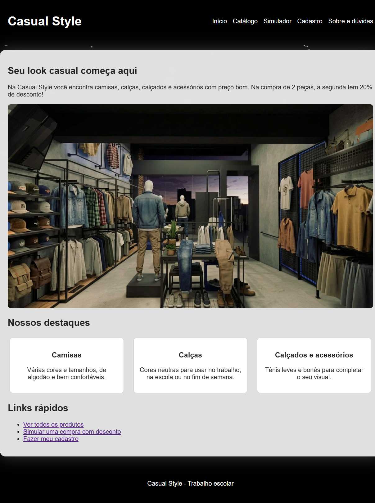
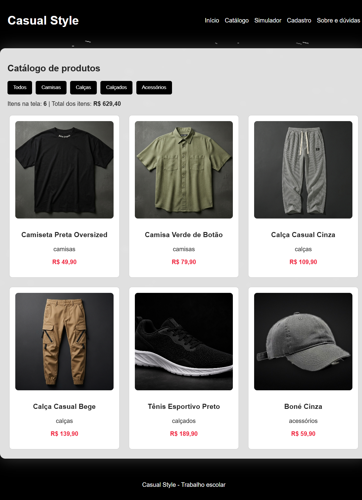
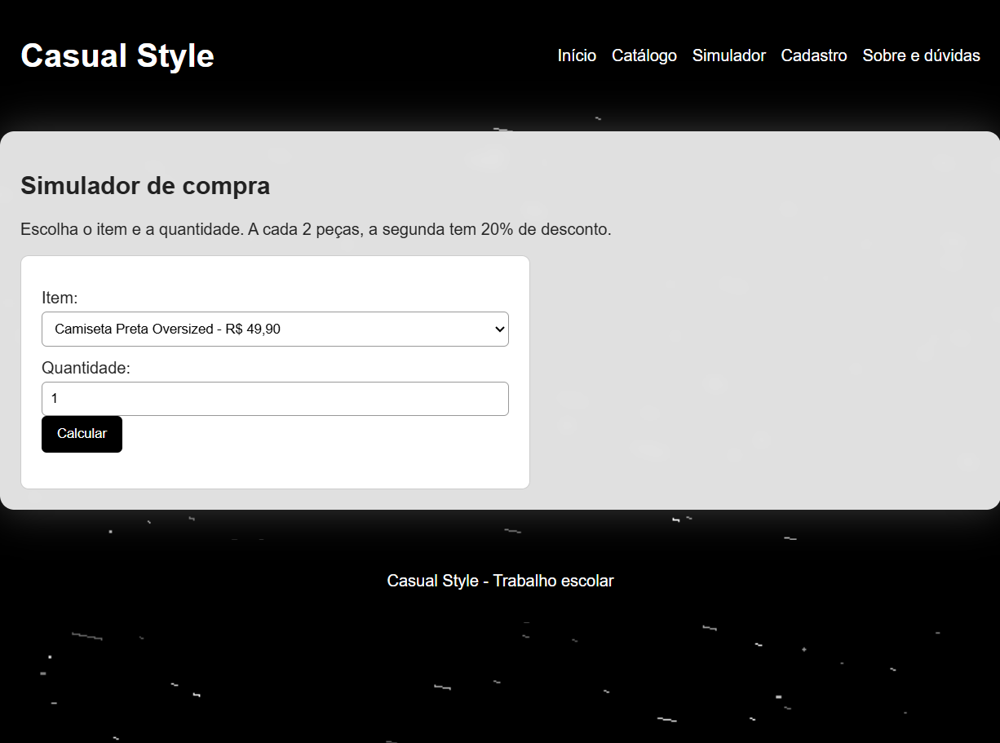
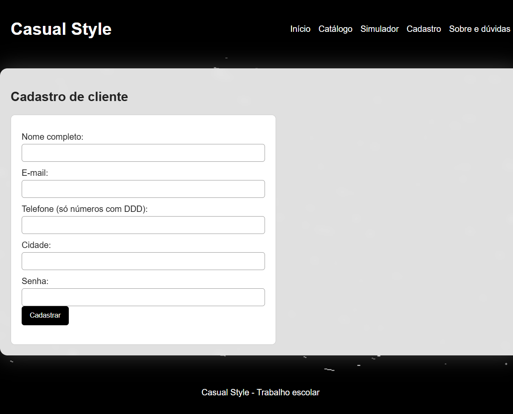
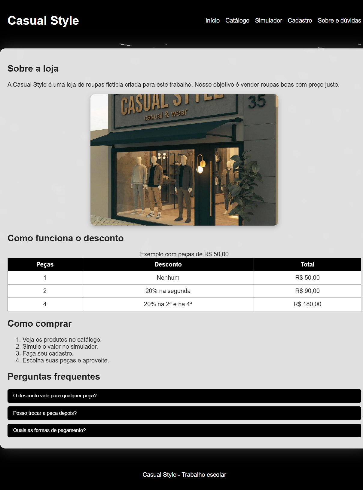
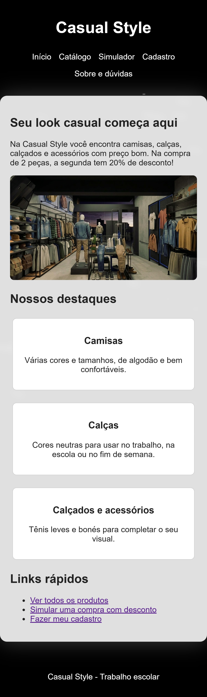

# Casual Style

A **Casual Style** é uma loja de roupas fictícia que criei como atividade prática do curso no SENAI. A ideia foi montar um site de 5 telas, do zero, usando HTML, CSS e JavaScript, e entregar tudo versionado no GitHub.

O tema do projeto é **loja de roupas**, com camisas, calças, calçados e acessórios para o dia a dia. A loja tem uma promoção simples: **na compra de 2 peças, a segunda tem 20% de desconto.**

## Prints

**Início**

**Catálogo**

**Simulador**

**Cadastro**

**Sobre e dúvidas**

**Versão celular**

##  As 5 telas

Todas as telas compartilham o mesmo menu, então dá para navegar entre elas de qualquer lugar.

1. **Início (index.html): apresentação da loja, imagem de capa, 3 destaques (camisas, calças, calçados e acessórios) e links rápidos para as outras páginas.
2. **Catálogo (catalogo.html): os produtos aparecem em cartões criados pelo JavaScript a partir de um array de objetos. Dá para filtrar por categoria, e um contador mostra quantos itens estão na tela e o total.
3. **Simulador (simulador.html): escolha o produto e a quantidade e veja o total da compra, já aplicando a regra especial da loja (a segunda peça com 20% de desconto).
4. **Cadastro (cadastro.html): formulário com nome, e-mail, telefone, cidade e senha, todos validados com JavaScript, com mensagens de erro claras embaixo de cada campo.
5. **Sobre e dúvidas (sobre.html): história da loja, tabela, lista ordenada e perguntas frequentes que abrem e fecham com um clique.

## O que eu usei

- **HTML5** com tags semânticas (header, nav, main, section, article, footer), imagens com alt, tabela, listas e formulário com label.
- **CSS** em um único style.css:
  - cores guardadas em variáveis no :root
  - cartões com box model, flexbox, efeitos de hover e focus
  - layout responsivo para celular com media query de até 600px
- **JavaScript** em um único script.js:
  - array de objetos com os produtos
  - funções para renderizar os cartões, filtrar, calcular o total e validar o formulário
  - filter, eventos de click e submit com preventDefault, e if/else
 - **Git e GitHub** para controlar as versões, com commits pequenos e mensagens claras.

## Validações do cadastro

O formulário só é aceito quando:

- o **nome** tem pelo menos 3 letras
- o **e-mail** tem formato válido (com "@" e ".")
- o **telefone** tem DDD e o número completo, só com dígitos
- a **cidade** foi preenchida
- a **senha** tem pelo menos 6 caracteres

Se algo estiver errado, o site mostra o aviso embaixo do campo e a mensagem "Corrija os erros acima". Se estiver tudo certo, aparece "Cadastro feito com sucesso!".

## Autor

**Jadson Inacio Agostinho dos Santos**
Turma: *TEC.206.060*
SENAI Areias

> A Casual Style é uma loja **fictícia**, criada apenas para fins de estudo. Os produtos e preços não são reais.
